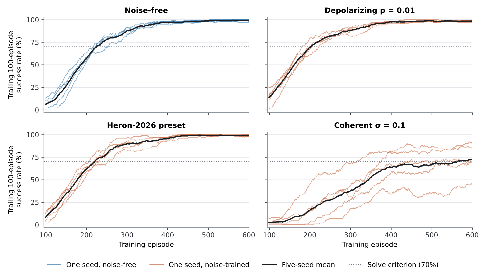
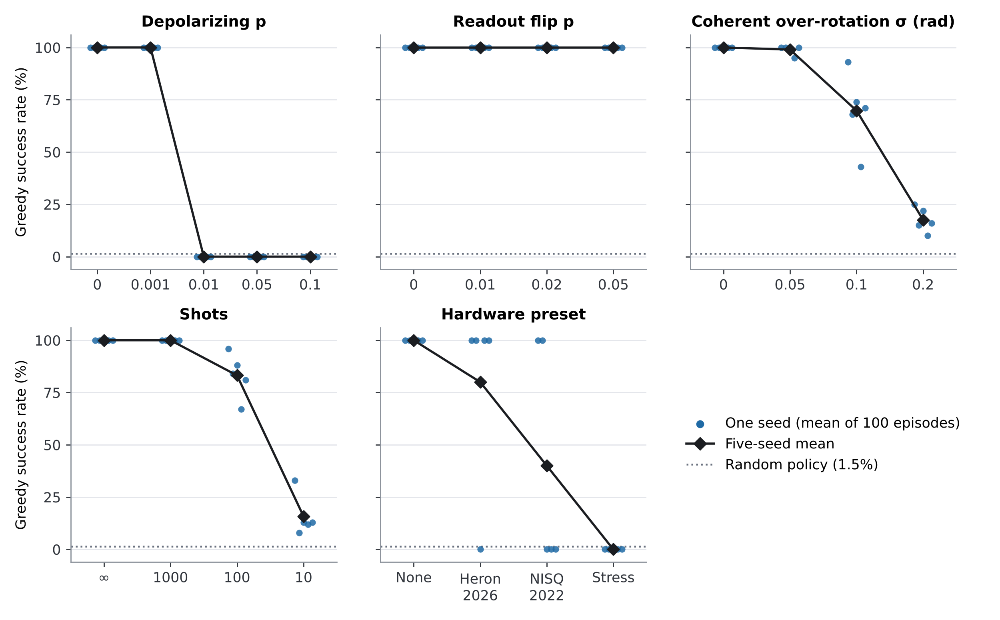
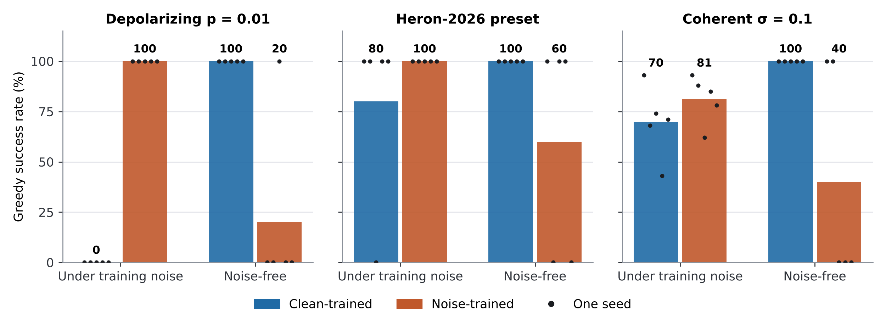
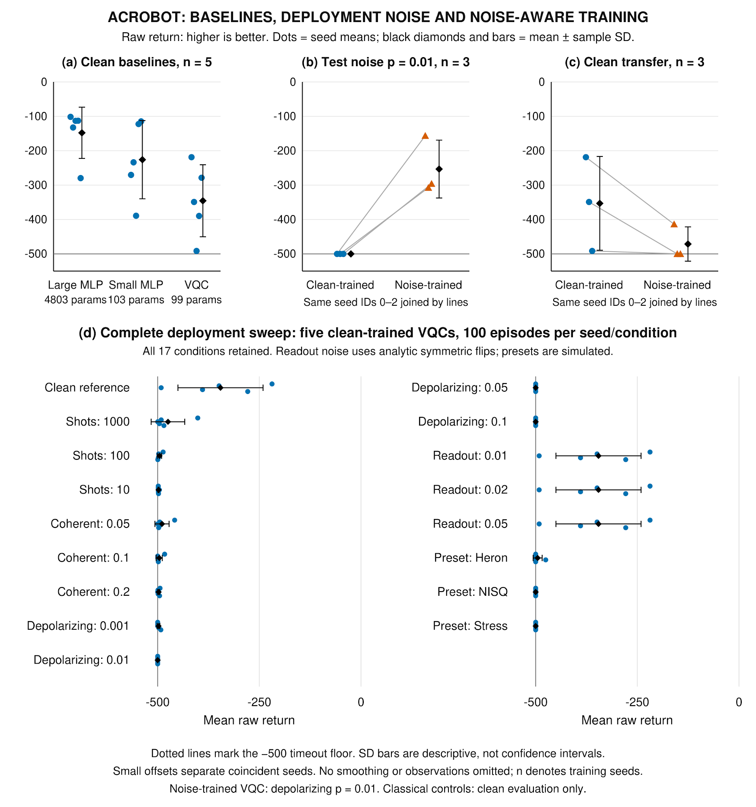
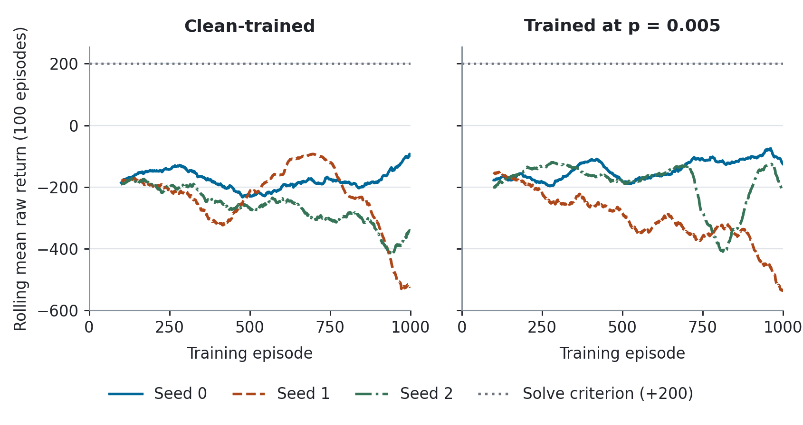
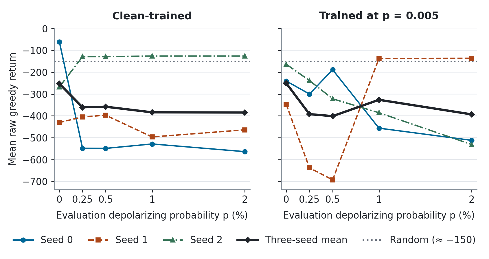

# SC4055 Group 1: How much hardware noise can a quantum RL agent tolerate?

> **Research question.** How much hardware-like noise can a variational-quantum-circuit (VQC)
> reinforcement-learning agent tolerate, how does that tolerance shrink as the task and the
> circuit grow, and does training under noise win any of it back?

We train VQC agents with DQN on four Gymnasium tasks of increasing size. Every task uses the
same codebase, the same noise menu and the same normalized score, so all four results can
sit on one plot and support one argument instead of being four separate demos.

| | FrozenLake-v1 | CartPole-v1 | Acrobot-v1 | LunarLander-v3 |
|---|---|---|---|---|
| Qubits | 4 | 4 | 6 | 4 (hybrid 8→4 encoder) |
| Owner | P2 | P1 | P3 | P4 |
| Noise-aware training | full sweep | full sweep | 1 condition, 3 seeds | evaluation only |
| Threshold | 0.70 (we use the deterministic map) | 475 | −100 | 200 |

## Team and responsibilities

| | Member | Task | Shared component | Report / video | Guide | Status |
|---|---|---|---|---|---|---|
| **P1** | Le Nguyen Bao Huy | CartPole | `qrl/agent.py`, `qrl/dqn.py` (QAgent + DQN loop) | Method section, video intro | [docs/members/P1.md](docs/members/P1.md) | ✅ Done: clean + noise-aware training (p = 0.005, 0.01), 3 seeds; results in report |
| **P2** | Poobanchuen Panjapong | FrozenLake | `qrl/noise.py`, presets, tests | Noise-model section, **report editor** | [docs/members/P2.md](docs/members/P2.md) | ✅ Done: Exp A/B/C × 5 seeds, Qiskit cross-check passes; [FrozenLake results](docs/p2_frozenlake_results.md) |
| **P3** | Wang Jianning | Acrobot | `qrl/evaluate.py`, `analysis/` | Results figures, **video editor** | [docs/members/P3.md](docs/members/P3.md) | ✅ Exp A/B/C done (15 clean runs; 5-seed noise sweep; 3 noisy runs); [Acrobot results and figures](results/acrobot/overview/README.md) |
| **P4** | Yang Mingchen | LunarLander hybrid | MLP baselines, `qrl/envs.py` | Related work, limitations, conclusion | [docs/members/P4.md](docs/members/P4.md) | ✅ Done: hybrid trained clean and at p = 0.005 × 3 seeds, 5-level noise sweep; not solved |

Group 1 members: Le Nguyen Bao Huy, Yang Mingchen, Poobanchuen Panjapong, Wang Jianning.
**Put your name in the table above and update your Status cell in your PRs.**
Status last updated 19 Nov 2026. Each member's result graphs are under their section below
(images in [`docs/figures/`](docs/figures/), the same figures as the report appendix).
Overview of all guides and milestone dates: [docs/members/README.md](docs/members/README.md).

### P1: CartPole + core agent
CartPole is the reference task. P1 reproduces Skolik et al.'s depolarizing threshold (CartPole
solves at p ≤ 0.01 and fails at p = 0.1) and builds the shared `QAgent` and DQN loop. The circuit
is 4 qubits and 5 layers, with arctan re-uploading, trainable input scaling, RX/RY/RZ layers
with a CZ ring, and trainable output weights. The FrozenLake code is the working template to
generalize. P1 may also add an optional REINFORCE comparison.
→ [Full guide](docs/members/P1.md)

**Status: done.** CartPole solves when trained clean (mean return 500), but the clean agent
collapses under deployment noise (18.1 at p = 0.005, 12.0 at p = 0.01). Noise-aware training
recovers near-optimal return at the matched level (472.9 at p = 0.005, 499.4 at p = 0.01), at
the cost of clean performance. Mean greedy return ± SD over 3 seeds:

| Evaluation noise p | Clean-trained | Trained at p = 0.005 | Trained at p = 0.01 |
|---|---|---|---|
| 0 | 500.00 ± 0.00 | 68.94 ± 97.71 | 41.96 ± 48.74 |
| 0.005 | 18.10 ± 11.58 | **472.94 ± 46.86** | 69.51 ± 41.78 |
| 0.01 | 12.02 ± 4.17 | 20.24 ± 13.67 | **499.44 ± 0.96** |

*Result graph: not available yet. The report has the CartPole table only and no CartPole
figure exists in the repo; P1, add one to `docs/figures/` and link it here.*

### P2: FrozenLake + noise module
FrozenLake is the smallest task, so it carries the most complete noise study: the full
Experiment B sweep, noise-aware training (Experiment C), and shot-noise training with
parameter-shift. P2 also owns the noise module, the hardware presets, the Qiskit cross-check of
the noise model, and the unit tests. Current state: 4 qubits, 5 layers, 68 parameters. All 5
seeds solve the deterministic map at episodes 217–248 with 100% greedy success, at about
30 s per seed, and training under depolarizing 0.01 also solves.
→ [Full guide](docs/members/P2.md)

**Status: done.** Clean training: 5/5 seeds solve (median 223 episodes, 100% greedy success).
Clean agents fail completely at depolarizing p = 0.01 (0%) but are untouched by readout error
up to 0.05; Heron-2026 preset gives 80%. Noise-aware training at p = 0.01 restores 100% success.
Full write-up: [docs/p2_frozenlake_results.md](docs/p2_frozenlake_results.md).


*Training curves for the four training conditions (clean, depolarizing 0.01, Heron-2026, coherent 0.1), 5 seeds each.*


*Clean-trained agents under each deployment condition (success rate, 100 greedy episodes per seed).*


*Noise-aware training: clean-trained vs noise-trained success at the training noise.*

### P3: Acrobot + evaluation and figures
Acrobot (6 qubits) tests whether noise tolerance shrinks as the circuit grows. Noisy training
is expensive at 6 qubits, so Experiment C is one condition with 3 seeds. P3 builds the shared
evaluation harness, which runs every checkpoint under all 17 noise conditions, and the analysis
scripts: normalized scores, the headline score-vs-noise figure, noise tolerance vs qubit count,
and the C-vs-B comparison.
→ [Full guide](docs/members/P3.md)

**Status: done.** No Acrobot run reached the −100 solve criterion. Clean returns: large MLP −147.9,
small MLP −226.1, VQC −345.5 (5 seeds). Depolarizing p = 0.01 drives the clean VQC to the −500
floor; noise-aware training at p = 0.01 lifts matched-noise return by 246.7 points (all 3 seeds)
but costs 118.2 points of clean return. More figures: [results/acrobot/overview](results/acrobot/overview/README.md).


*(a) clean baselines, (b–c) clean- vs noise-trained VQC at p = 0.01 and clean, (d) all 17 deployment conditions.*

### P4: LunarLander hybrid + classical baselines
LunarLander uses a hybrid model: a classical 8→4 encoder feeds a 4-qubit VQC. An
encoder-only ablation shows whether the quantum layer carries any weight. This task is
evaluation-only under noise, and the go/no-go decision is on Sun 1 Nov. P4 also builds the
classical baselines for all four tasks: a parameter-matched MLP and a large 2×64 MLP.
→ [Full guide](docs/members/P4.md)

**Status: done (task not solved).** None of the six hybrid runs reached +200; the best 100-episode
rolling mean was −75. Only seed 0's clean checkpoint beat random (−61), and it fell to −548 at
p = 0.0025. Noise-aware training at p = 0.005 gave no reliable recovery (−401 vs −358 at matched
noise). Training-setup diagnosis: [analysis/lunarlander/README.md](analysis/lunarlander/README.md).


*Training curves (trailing 100-episode mean), clean-trained and trained at p = 0.005, 3 seeds.*


*Final-checkpoint greedy return across five depolarizing levels (20 episodes per seed).*

## The protocol (every task)

| Experiment | What | Seeds |
|---|---|---|
| **A** noise-free training | VQC, parameter-matched MLP, large MLP | 0–4 |
| **B** train clean, evaluate noisy | each VQC checkpoint, 100 greedy episodes under each of 17 noise conditions | 0–4 |
| **C** noise-aware training | retrain under depolarizing 0.01, coherent σ = 0.1, Heron-2026; compare with B | 0–4 (Acrobot: 1 condition × 3) |

**Normalized score** = (R − R_random) / (R_threshold − R_random). Headline figure: normalized score vs
noise strength, one line per task. Details: [docs/run_matrix.md](docs/run_matrix.md),
[docs/analysis_spec.md](docs/analysis_spec.md), [docs/team_plan.md](docs/team_plan.md).

Noise strings (used on every command line and in every CSV): `none`, `shots=N`, `coherent=σ`,
`depolarizing=p`, `readout=p`, `preset=heron2026|nisq2022|stress`.

## Milestones

| Date | Milestone |
|---|---|
| Fri 23 Oct | Everyone: `bash setup.sh` prints `ALL OK` |
| Sun 25 Oct | Shared components merged (agent/DQN, evaluate, MLP baselines) |
| **Wed 28 Oct** | **M1:** every task trains a noise-free VQC on 1 seed; protocol frozen |
| **Sun 1 Nov** | **M2:** Experiment A done; LunarLander go/no-go |
| **Wed 4 Nov** | **M3:** Experiments B and C done |
| Thu 5 Nov | Analysis meeting: agree 3–4 headline claims |
| **Sun 8 Nov** | **M4:** report draft, slides, recorded 15-min video |
| **Fri 13 Nov** | Submit the PDF report plus video and code links by email (see the brief in `docs/`) |

## Setup

First run the following commands to clone the repo and update pip.
```bash
git clone https://github.com/Cryogenic2005/SC4055-Project.git
cd SC4055-Project
pip install --upgrade pip
```

Package installation (for development):
```bash
pip install -e . --group dev # Install with development dependencies (pytest, black, mypy, etc.)
```bash
pip install -e .[qiskit]  # Install with Qiskit
```
```bash
pip install -e .[jupyter]  # Install with Jupyter
```

Otherwise, install the minimal dependencies for running the tasks:
```bash
pip install .
```


## Repository layout

```
src/sc4055_project/  Project source code
  qrl/                 shared package
    config.py          Config dataclass (env, model, circuit, noise, DQN hyperparameters)
    envs.py            make_env, per-task encoders, random baseline            (P4)
    noise.py           NoiseSpec, parse_noise, NOISE_MENU, presets, make_device, apply_noise  (P2)
    logging_utils.py   TrainLogger / EvalLogger with the analysis-spec columns
    agent.py           shared QAgent interface                                 (P1, stub)
    dqn.py             shared DQN loop                                         (P1, stub)
    evaluate.py        shared evaluation harness                               (P3, stub)
  tasks/
    frozenlake/        P2: agent.py, train.py, evaluate.py (complete reference implementation)
    cartpole/          P1
    acrobot/           P3
    lunarlander/       P4: agent.py, train.py, evaluate.py (hybrid + encoder_only + MLP baselines)
  frozenlake.py        Entry point for the frozenlake task
  baseline.py
tests/               pytest: noise contractions, agent shapes/jit/gradients, logger columns
analysis/            P3: analyze.py and figures
runs/                train/*.csv, eval/*.csv, random.csv, checkpoints/ (git-ignored)
docs/                team plan, run matrix, analysis spec, project brief, members/ guides
```

## Quick start

As of now, the following commands are available:
```bash
baseline [task]       # Run baseline on the specified task (or all of them)
# Equivalent to `python src/sc4055_project/frozenlake.py (...)`
cartpole train        # Train CartPole-v1 (VQC by default; supports --model)
cartpole evaluate     # Evaluate a CartPole checkpoint under the noise menu
frozenlake train      # Train the model on FrozenLake-v1 task
frozenlake evaluate   # Evaluate the model on FrozenLake-v1 task
lunarlander train     # Train the hybrid VQC (or --model encoder_only|mlp_small|mlp_large) on LunarLander-v3
lunarlander evaluate  # Evaluate a LunarLander checkpoint under the 17-condition noise menu
``` 

### For developers

`[project.scripts]` in `pyproject.toml` helps define task entry points for convenient execution.

To add your own tasks, modify `[project.scripts]` in `pyproject.toml` and add the your entry point `main` function (or equivalent). Example, adding:
```toml
# in [project.scripts]
mytask = "sc4055_project.myfilename:function"
```
will allow you to run `mytask` from the command line, which will call `function` in `myfilename.py` in the `sc4055_project` package, instead of having to run `python -m src/sc4055_project/myfilename`.

**NOTE**: To update this change, you will need to reinstall the package with `pip install -e .`, or whatever you used to install this package.

## How we work

Read [CONTRIBUTING.md](CONTRIBUTING.md). In short:
- Branch `p<N>/<topic>` and open small PRs; the owner of a shared module reviews changes to it.
- `python -m pytest -q` and `python scripts/smoke_test.py` must pass before you push (CI checks both).
- Use the shared loggers and do not rename CSV columns. P3's analysis depends on them.
- Never combine shots with backprop. Use `default.mixed` only when channel noise is on.

## Conventions that protect the correctness marks

- `depolarizing=p` is PennyLane's `DepolarizingChannel(p)` after every gate, per wire. A
  device's average gate error ε is converted with `gate_error_to_depol_p` (ε = 2p/3 for one qubit).
- Readout error is a symmetric `BitFlip(p)` on every measured wire right before measurement,
  so ⟨Z⟩ → (1−2p)⟨Z⟩. PennyLane 0.45.1's `default.mixed(readout_prob=…)` is broken (see
  `qrl/noise.py`); a test guards the workaround.
- Shots are never combined with backprop. A shots device switches to parameter-shift.
- Presets use exact expectation values, so shot noise stays its own axis in the sweep.
- "Solved" = mean of last 100 episodes ≥ `env.spec.reward_threshold` (CartPole: 475, which is
  the registered value; the docs say 500).

## Known integration issues (fixed)

| Issue | Fix |
|---|---|
| JAX 0.12 + PennyLane 0.45: `jax.core has no attribute is_concrete` | pin `jax[cpu]==0.10.2` |
| `gymnasium[box2d]` fails to build | `pip install swig` first (setup.sh does it) |
| `default.mixed(readout_prob=p)` → `TypeError: 'float' object is not iterable` | explicit `BitFlip` before measurement |
| Shots device inside `jax.vmap`/`jit` → `ConcretizationTypeError` | shots path loops in Python, no jit |
| Q = w(⟨Z⟩+1)/2 (Skolik) cannot represent negative shaped rewards; training stalled at 0 | FrozenLake uses Q = w⟨Z⟩ |
| Late training collapse (train mean 1.0, greedy 0.0 at the end) | greedy eval every 25 episodes, `best.pkl` kept next to `final.pkl` |
| Random baseline measured on the slippery map while training used the deterministic one | baseline uses the task config's env kwargs |
| FrozenLake MLP baseline would see the raw state index | MLPs get a 16-way one-hot (`envs.one_hot_obs`) |
