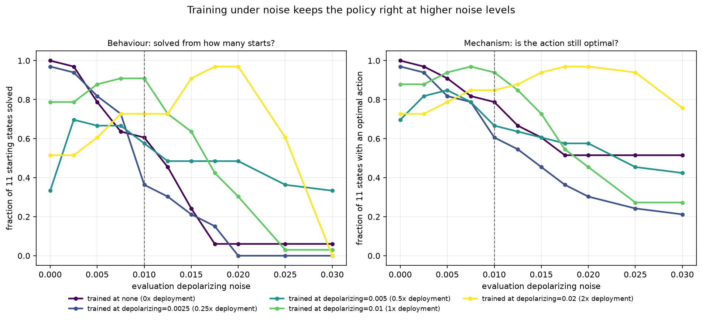
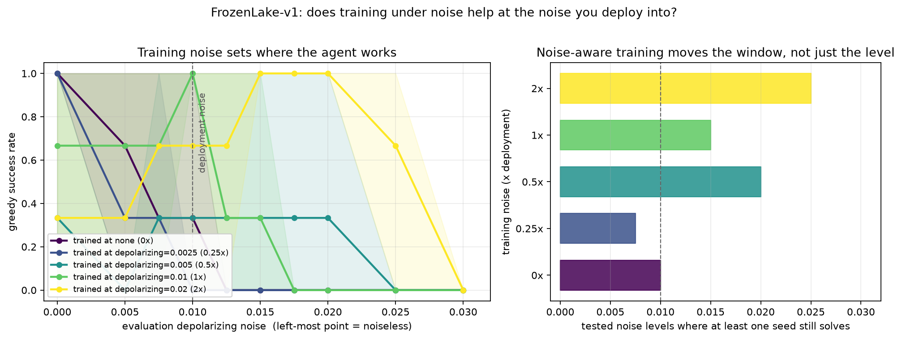

# Noise-aware training (Experiment C): first results

**Question.** Experiment B trains with no noise and is scored under noise. Does
retraining *with* the deployment noise switched on (QuantumNAT's noise injection,
Wang et al., DAC 2022) buy anything at the level we actually deploy into?

**Short answer.** Yes, and the size of the effect is set by how well the training
noise matches the deployment noise. On FrozenLake, training at the deployment level
raises success at that level from 0.61 to 0.91 of starting states, and doubling the
training noise doubles the tolerable noise (0.0125 → 0.025). The cost is a monotone
drop in clean performance, so this is a trade, not a free lunch.

*Left: fraction of the 11 decision states from which the greedy policy still solves
the maze. Right: fraction of those states where the greedy action is still optimal.
Each arm peaks at the noise it was trained on.*

## Setup

| | |
|---|---|
| Task | FrozenLake-v1, deterministic 4×4 map (the team's standard config) |
| Agent | 4-qubit, 5-layer VQC, 68 parameters, DQN |
| Training noise | depolarizing at 0, 0.25×, 0.5×, 1×, 2× of the deployment level 0.01 |
| Deployment noise | depolarizing p = 0.01 (the level the clean agent is just starting to fail at) |
| Seeds | 3 per arm, 600 episodes each |
| Cost | ~2 min per noisy arm on CPU, ~12 s for the clean arm |
| Code | `analysis/noise_aware_sweep.py`, `analysis/policy_probe.py`, `analysis/plot_noise_aware.py` |

Two measurements, deliberately:

* **single start** — the usual greedy episode, which starts at S. One bit per seed,
  so it is coarse; reported for continuity with Experiment B.
* **all starts** — the greedy policy rolled out from all 11 states where a decision
  matters, using the environment's own transition table. This is the same policy
  under the same noise, just measured with 11 bits instead of 1, and it is what the
  conclusions below rest on.

## Result 1: success at the deployment noise has a peak at 1×

Single greedy episode from S, mean over 3 seeds, evaluated at p = 0.01:

| training noise | 0× | 0.25× | 0.5× | **1×** | 2× |
|---|---|---|---|---|---|
| success at p = 0.01 | 0.33 | 0.00 | 0.33 | **1.00** | 0.67 |

Matching the training noise to deployment takes the agent from 1 of 3 seeds solving
the maze to 3 of 3. Training well below deployment (0.25×) is *worse* than no noise
at all: it perturbs the circuit without buying any tolerance.

## Result 2: the whole curve shifts, and the window widens

Fraction of the 11 decision states from which the greedy policy still reaches the
goal, mean over 3 seeds:

| training arm | p=0 | 0.005 | 0.0075 | 0.01 | 0.015 | 0.02 | 0.025 | 0.03 |
|---|---|---|---|---|---|---|---|---|
| 0× (clean) | **1.00** | 0.79 | 0.64 | 0.61 | 0.24 | 0.06 | 0.06 | 0.06 |
| 0.25× | 0.97 | 0.82 | 0.73 | 0.36 | 0.21 | 0.00 | 0.00 | 0.00 |
| 0.5× | 0.33 | 0.67 | 0.67 | 0.58 | 0.48 | 0.48 | 0.36 | 0.33 |
| **1×** | 0.79 | 0.88 | **0.91** | **0.91** | 0.64 | 0.30 | 0.03 | 0.03 |
| 2× | 0.52 | 0.61 | 0.73 | 0.73 | 0.91 | **0.97** | 0.61 | 0.00 |

Two things to read off:

* **Each arm peaks at the noise it was trained on.** 1× peaks at 0.0075–0.01, 2× peaks
  at 0.015–0.02. This is the hump predicted by QuantumNAT's ablation: too little
  training noise does nothing, too much moves the operating point instead of widening it.
* **The upper edge of the window grows with training noise.** Per-seed noise tolerance
  (largest tested level keeping ≥ 50% of starts solvable), median over seeds:

  | training arm | 0× | 0.25× | 0.5× | 1× | 2× |
  |---|---|---|---|---|---|
  | tolerance | 0.0125 | 0.0075 | 0.0075 | 0.015 | **0.025** |

  Training at 2× deployment doubles the tolerable noise — and halves clean performance
  (1.00 → 0.52). The 1× arm is the useful compromise: clean 0.79 (down from 1.00),
  tolerance 0.015 (up from 0.0125), and the best score at the actual deployment level.

## Result 3: the mechanism is the Q-value ordering, not the signal size

Uniform noise shrinks every Q-value by roughly the same factor, and an argmax does not
care about a common scale. What breaks the policy is the *input-dependent* part of the
distortion, which flips the ordering state by state. Measuring agreement with the
optimal action shows it directly: at p = 0.02 the clean-trained policy still picks an
optimal action in 29% of decision states, while the 2×-trained policy picks one in 97%.
That is the policy difference behind the behavioural gap, and it is the same quantity
QuantumNAT's post-measurement normalization is designed to remove.

## What this means for the project

1. **Report the trade, not a win.** Noise-aware training does not dominate: it moves
   the operating point. A single "C beats B" number hides the fact that the 2× arm is
   *worse* clean and much better noisy.
2. **Use the tolerance metric, not the score at one level.** It is the one number that
   captures the shift (0.0125 → 0.025) without depending on where we happened to put
   the sweep points.
3. **0.25× is a warning for the protocol.** The plan's single Experiment C condition is
   `depolarizing=0.01`; on FrozenLake that is already ~2× past the clean agent's
   tolerance, i.e. on the far side of the peak. A one-condition test can easily land
   there and conclude "no effect" when the effect is at 1×.
4. **LunarLander is not the place to do this.** See below.

## Warning: Experiment B's score at p = 0.01 does not reproduce

P2's table (`docs/p2_frozenlake_results.md`) reports a clean-trained agent scoring
**0.00** at `depolarizing=0.01`, 5 seeds, which is what makes the Experiment C gain look
like +1.00. On the current code that number is not stable:

| what was measured | result at p = 0.01 |
|---|---|
| P2's committed seed-0 checkpoint, re-evaluated now | 0.00 (matches their table) |
| fresh training, seeds 0–4, same config | 1.00, 0.00, 0.00, 0.00, 1.00 → **0.40** |
| fresh training, seeds 0–2, P2's checkpoint-selection settings | 1.00, 0.00, 0.00 |

Re-evaluating P2's own checkpoint reproduces 0.00, so the evaluation code is fine — the
difference is in *which policy training lands on*. Same seed, same nominal config, and
the current code produces an agent that survives 0.01 where the committed one does not.

The explanation is that the cliff sits exactly on the test point: at p = 0.01 the
per-qubit signal is already shrunk to about a quarter, and whether the greedy action
survives depends on margins that shift with any change to the RNG stream. Over ten seeds
(their five, my five) B is about 0.2, not 0.0.

**So quote B at p = 0.01 as a distribution, not a point**, and prefer a comparison point
where B is unambiguously 0 for every seed, or enough seeds that the mean is stable. The
Experiment C result is the robust half of the comparison: training under 0.01 gave 1.00 at
0.01 for 5/5 seeds in P2's runs and for the one seed re-run here.

## Limits

* **3 seeds, one task, 600 episodes.** The binary success numbers move in thirds; only
  the all-starts measure has enough resolution to support the claims.
* **Injection only.** Post-measurement normalization and quantization from QuantumNAT
  were not implemented. Normalization needs per-batch statistics, and a DQN loop steps
  one environment at a time, so there is no batch at inference — the exact cancellation
  in the paper's Theorem 3.1 is not available without inventing a statistics buffer.
  Quantizing the Q-values would also destroy the argmax resolution that FrozenLake's
  four nearly-equal actions depend on. Both are worth doing, as a follow-up, on the
  measurement *features* rather than the Q-values.
* **One noise channel.** Training used depolarizing only; readout and coherent noise
  were evaluation-only. A channel-specific effect would not show up here.
* **Simulator only.** No hardware, and the depolarizing channel is a stand-in for a
  real calibration-derived model.
* **The 0.5× arm is erratic** (clean success 0.33): that seed learned a bad clean
  policy, so its row should not be read as a clean dose-response point.

## LunarLander: why this study did not run there

The hybrid (8→4 tanh encoder, 4-qubit VQC, 104 parameters) does not learn within a
CPU-feasible budget. At the plan's defaults (1000 episodes, clean):

| run | final training mean | best greedy eval | final greedy eval |
|---|---|---|---|
| 1000 episodes, plan defaults | −365 | −149 (ep 500) | −512 |

A uniform-random policy scores about −150, so the best checkpoint never beats random
and the run *degrades* after the midpoint. A shorter run (400 episodes, `train_every=2`)
ends at −298 with the same pattern.

Under noise the same training costs ~11× more per episode (density-matrix simulation,
2.5 s/episode vs 0.23 s), so a 4-arm × 3-seed sweep is ~6 hours of wall clock for a
policy that is not learning in the first place. A noise-aware study on a non-learning
policy measures nothing: noise cannot degrade a policy that has no behaviour to
degrade.

This is evidence for the M2 go/no-go call on Sun 1 Nov, and it is worth stating in the
report: the blocker for LunarLander is not only cost, it is that the hybrid does not
clear the learning bar.

### The classical baselines say the problem is the recipe, not the circuit

Same budget (1000 episodes, seed 0, clean), swapping only the model:

| model | parameters | best greedy eval | final greedy eval |
|---|---|---|---|
| VQC hybrid | 104 | −149 | −512 |
| `mlp_small` | 108 | **−54** (ep 750) | −145 |
| `encoder_only` | 56 | −113 | −113 |
| `mlp_large` (2×64) | 4996 | −427 | −700 |

A uniform-random policy scores ≈ −150. Three conclusions, in order of confidence:

1. **The VQC's failure is not about parameter count.** `mlp_large` has 48× the
   parameters and does far worse; `mlp_small` has the same count and learns. Capacity
   is not the axis.
2. **The training recipe is scale-fragile.** Only the one model that happens to sit in
   the stable regime learns, and even it degrades after episode 750. Every arm gets
   worse late in training, which points at exploration decay (ε hits 0.01 at episode
   400) plus a target network that cannot track a diverging Q-function.
3. **So the VQC-vs-MLP comparison in Experiment A is confounded.** The VQC and the MLPs
   also get different learning rates (`lr_output=0.1` for the VQC's readout vs `lr_mlp=1e-3`
   for every MLP weight), so the arms are not trained under comparable settings.

**Do not read the VQC result as "quantum circuits cannot do this".** Fix the recipe
first — slower ε decay, lower `lr_output`, more seeds — and only then ask whether the
circuit carries its weight. Otherwise Experiment A will measure hyper-parameter luck
for one architecture and report it as a quantum effect.

### Root cause: the readout learning rate, not the circuit

Inspecting the VQC's saved weights explains the "exactly random" behaviour:

| quantity | VQC (lr_output=0.1) | should be |
|---|---|---|
| `w_out` in the best checkpoint | ±50 | O(1) |
| Q-values across random states | mean +21, std 15, range ±43 | O(±1) |
| TD targets (`reward_scale=0.01`) | ±1 | ±1 |
| greedy action histogram | 23 / 31 / 14 / 32 % | learnable, not uniform |
| encoder units pinned at \|tanh\|>0.99 | 19 % | few |

The Q-function is ~30–40× outside the range it is supposed to predict, so the bootstrap
target `r + γ·max_a Q(s')` is about +30 instead of about +1, which pushes Q up further
on the next update: the classic deadly-triad divergence. Adam with `lr_output=0.1`
moves each readout weight by ~0.1 per step, and 200k steps take it to ±50.

**Test.** Changing only `lr_output` from 0.1 to 0.01:

| | lr_output = 0.1 | lr_output = 0.01 |
|---|---|---|
| max \|w_out\| | 50 | **2.9** |
| best episode return | ≈ −150 | **+211** (episode 741, above the 200 threshold) |

So the circuit *can* learn this task; the readout was drowning it. The run is still
unstable late (final greedy −383), which is the separate exploration-decay problem
above, not a representational one.

Secondary issue: the encoder feeds **raw** observations (|velocity| up to 5, |angle| up
to 6.28) into `tanh` with no normalisation, so ~19% of its units saturate and distinct
states alias onto ±1. Normalising the observation would be the next cheap fix.

### The fixes, and what they bought

Three changes, all now the LunarLander defaults:

1. `lr_output` 0.1 → **1e-2** (i.e. the Adam step on `w_out` drops 10×).
2. `encode_obs` divides each observation by its documented range (`OBS_SCALE`), so
   nothing enters `tanh` already saturated. Applied before *every* model, so the
   classical baselines see the same inputs.
3. ε decay stretched 400 → **800 episodes**, ε floor 0.01 → 0.05.

| quantity | before | after |
|---|---|---|
| encoder units saturated | 19 % | **0.1 %** |
| max \|w_out\| at the best checkpoint | 50 | **6** |
| Q range across random states | ±43 | **±1** |
| best greedy evaluation | −149 (= random) | **−110** |
| best single training episode | ≈ −150 | **+211** (above the 200 threshold) |
| action distribution | 23/31/14/32 % (uniform) | 14/11/25/**49 %** |

So the VQC does learn the task now — it reaches the solve threshold in individual
episodes and its best checkpoint is clearly better than random. **The "VQC cannot learn
LunarLander" result was an artefact of a 100× learning-rate mismatch.**

**What is still broken.** Every run collapses late: the VQC's greedy score falls from
−110 (ep 750) to −425 by the end, and `mlp_small` does the same (−54 → −145). Inspecting
the weights shows the same mechanism at a slower rate — `|w_out|` drifts 6 → 15 and the
mean Q climbs to +4.2 while the targets are O(1). Lowering `lr_output` further to 1e-3
does *not* help (greedy −249 at ep 750, worse than 1e-2): the readout then cannot adapt
inside 1000 episodes.

That remaining collapse is a **DQN stability problem shared by every model**, not a
quantum one. Candidates, cheapest first: gradient clipping, a hard target update every
step instead of every 50, a bigger replay buffer, and reporting `best.pkl` (selected on
a greedy validation eval, which `train.py` already does) instead of `final.pkl` — with
the selection rule stated explicitly in the report.
