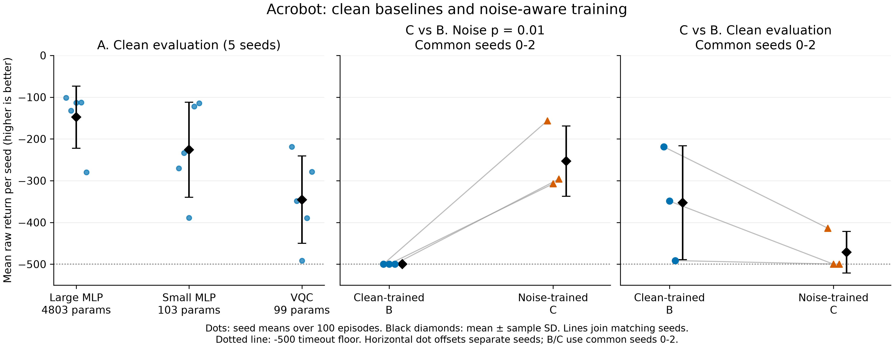
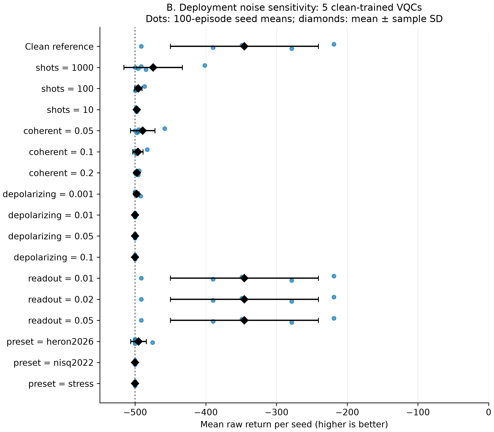

# Acrobot A/B/C: results and figures

## Main findings

1. **A: no observed VQC advantage.** Clean held-out mean returns over five seeds
   are -147.88 (large MLP), -226.05 (parameter-matched small MLP), and -345.48
   (VQC). This conclusion is limited to the tested configuration and budget.
2. **B: clean-trained VQCs are sensitive to deployment noise.** All five seed
   means reach the -500 timeout floor at depolarizing p >= 0.01. Finite shots
   and coherent errors also degrade performance. Symmetric analytic readout
   noise preserves greedy actions here because it scales all Q values equally
   by a positive factor; this is not general measurement-error immunity.
3. **C: matched-noise training recovers performance, with a transfer cost.**
   Using common seed IDs 0--2, matched-noise return improves from -500.00 to
   -253.29, while clean return changes from -353.06 to -471.24. All three
   matched-noise seed differences are positive. These are descriptive results
   from three replicates; no statistical significance claim is made.

Training solve status uses a raw rolling-100 training mean >= -100; none of
the Acrobot A or C runs reaches it. Do not infer solve status from one lucky
episode, one validation checkpoint, or a plotted evaluation mean.

## Figures



`ABC_overview.png` and `.svg` show all seed means. The first panel uses five
seeds per A model; the other panels restrict B/C to the same three seed IDs.
Small horizontal offsets separate coincident seed observations and have no
numerical meaning. Lines join matching seed IDs, not a time trajectory.
Black diamonds and error bars show mean +/- sample SD, not confidence intervals.
SD bars can extend below the physical -500 return floor; no observations do.



`B_noise_sweep.png` and `.svg` show all 17 B conditions with five seed means
each and mean +/- sample SD. Small vertical offsets separate seeds. Presets
are simulated hardware-style noise, not results from a physical quantum device.

The PNGs use 300 DPI; SVGs retain editable vector geometry/text. These are
general report/presentation figures, not certified journal-specific exports.
`ABC_summary.csv` supplies the headline numerical table. See the separate
[A](../experiment_A/README.md), [B](../experiment_B/README.md) and
[C](../experiment_C/README.md) tables for full protocols and limitations.

## Reproduce

From the repository root, using the pinned project dependencies:

```bash
python analysis/acrobot/report_abc.py
# Optional original-C-log verification:
python analysis/acrobot/report_abc.py --raw-dir /path/to/experiment_C_v3
```

The script reads the committed summaries, validates coverage and aggregate
statistics, and deterministically regenerates the paired table and figures.
It uses no smoothing, exclusions, invented data, bootstrap or episode-level
pseudoreplication. Means and sample SDs use training seeds as replicates.
`figure_manifest.json` records input hashes, plotting versions, dimensions,
uncertainty semantics and whether original C logs were verified in that run.

Personal Acrobot experiments and these figures are complete. The shared
cross-task evaluation/analysis integration and video editing remain separate
P3 responsibilities; the personal results do not mark those tasks complete.
